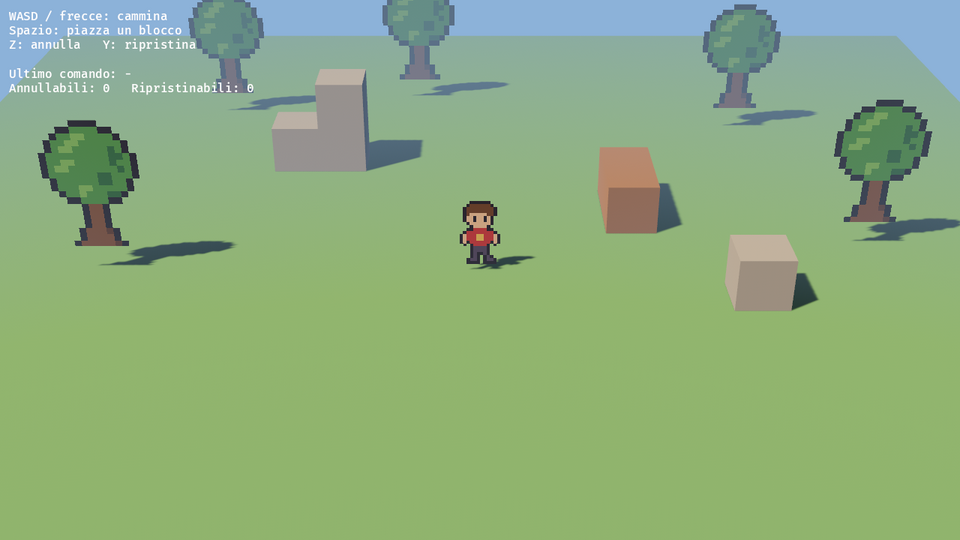

# Kamishibai 紙芝居

**An open source, AI-first game engine for 2.5HD games**: pixel-art sprites
living in lit 3D dioramas, built on [Bevy](https://bevy.org).

> *Kamishibai* is Japanese "paper theater": storytellers slide illustrated
> boards through a small wooden stage. This engine does the same with pixel
> art and real-time 3D light.



**Status: very early.** Nothing here is stable yet. Follow along, open issues,
share ideas.

## Goals

- **Specialized for 2.5HD**: billboard sprites that receive light and
  shadows, diorama cameras, depth of field, tile and block level building.
- **AI-first, hands-on too**: every change to a project is an undoable
  command. The editor, scripts and AI assistants (through an MCP server) all
  use the same commands, so anything an AI does can be reviewed and undone.
- **Mix gameplay styles**: exploration, real-time action and turn-based
  JRPG battles as combinable gameplay kits in the same game.
- **For everyone**: an editor that people who don't write code can use,
  with project templates and plain-language errors.
- **PC and mobile first**, consoles later.

## What works today

- `Billboard`: sprites that turn toward the camera (cylindrical or spherical).
- `pixel_sprite`: crisp, lit, shadow-casting pixel-art sprites in 3D.
- `DioramaCamera`: a narrow-angle camera that follows a `CameraTarget`.
- `EditCommand` + `EditHistory`: undo/redo for any change to the world.

## Try it

You need [Rust](https://rustup.rs) (1.97.1 or newer). On Linux, also install
Bevy's [system dependencies](https://github.com/bevyengine/bevy/blob/main/docs/linux_dependencies.md).

```sh
cargo run --example diorama
```

Walk with WASD or the arrow keys, press Space to place a block, Z to undo
and Y to redo. The first build takes a few minutes.

```rust,no_run
use bevy::prelude::*;
use kamishibai::prelude::*;

fn main() {
    App::new()
        .add_plugins((DefaultPlugins.set(ImagePlugin::default_nearest()), KamishibaiPlugin))
        .run();
}
```

## Roadmap

1. **Look 2.5HD**: billboard sprites with light and shadows, diorama camera,
   running on PC and Android.
2. **Gameplay basics**: 4/8-direction sprite animation, collisions,
   exploration kit, scenes saved as text files.
3. **Editor**: viewport, hierarchy, inspector, play/stop, all built on edit
   commands. *(MVP)*
4. **AI-first**: MCP server, assistant panel in the editor, Lua scripting.
5. **Gameplay kits**: real-time action and turn-based battles.
6. **Public alpha**: templates, documentation, community.

## License

Licensed under either of

- Apache License, Version 2.0 ([LICENSE-APACHE](LICENSE-APACHE))
- MIT license ([LICENSE-MIT](LICENSE-MIT))

at your option.

Unless you explicitly state otherwise, any contribution intentionally
submitted for inclusion in the work by you, as defined in the Apache-2.0
license, shall be dual licensed as above, without any additional terms or
conditions.
